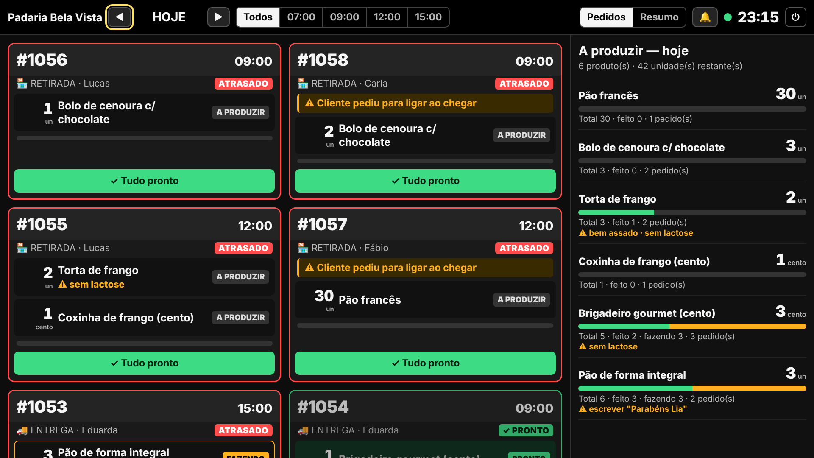
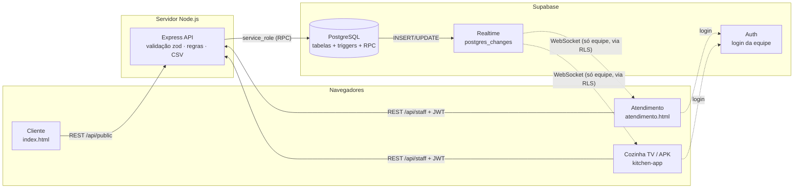
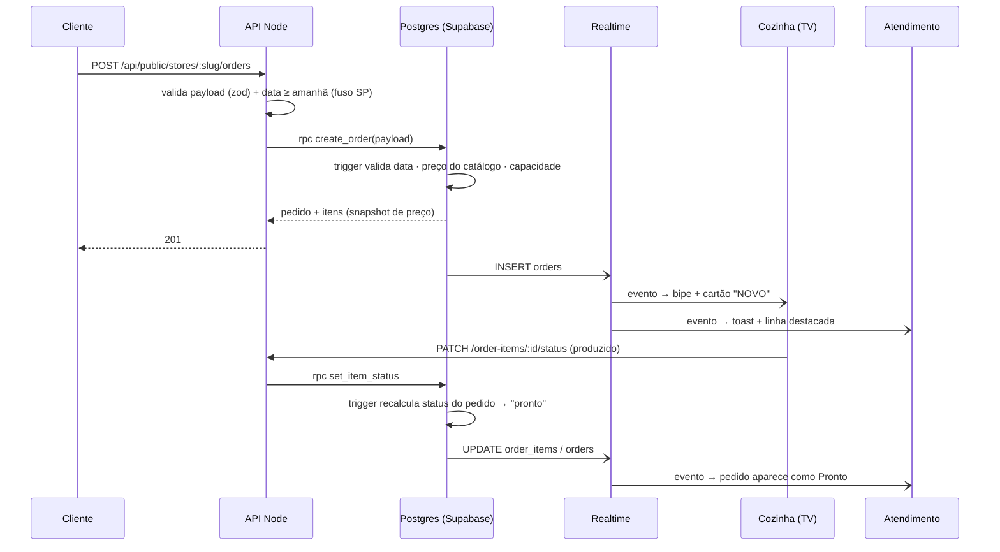
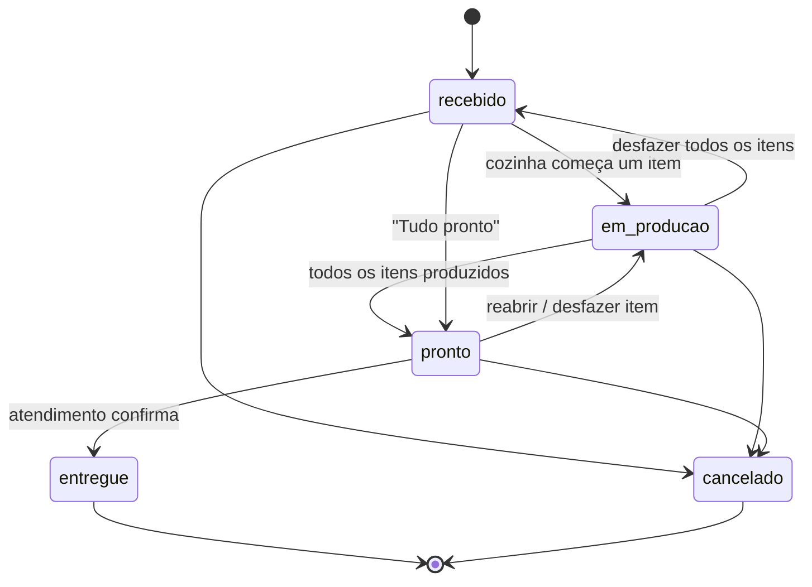
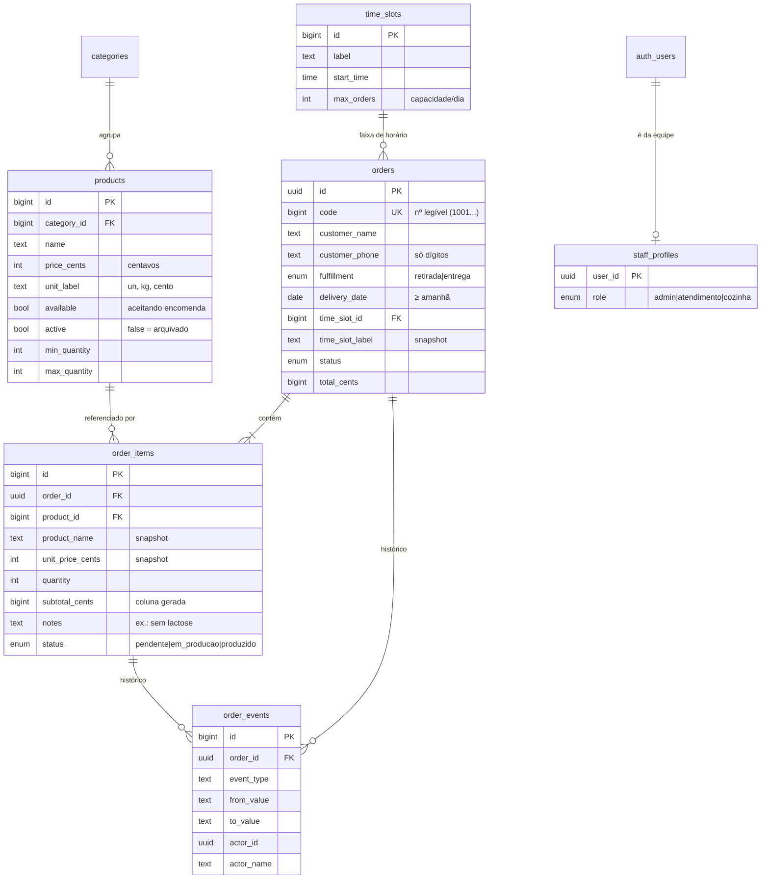

# 🥖 Sistema de Encomendas para Padaria

Sistema completo de pedidos por encomenda, **para vários estabelecimentos** (multi-loja), com telas que conversam em tempo real:

| Tela | Quem usa | Onde roda | Endereço |
|---|---|---|---|
| **Encomendas** | Cliente | Celular / computador | `/loja/<link-da-loja>` (e `/loja/<link>/acompanhar`) |
| **Atendimento + dashboard** | Balcão / gerência da loja | Computador | `/atendimento` |
| **Cozinha** | Padeiro | TV (APK Android) ou navegador | `/cozinha/` |
| **Painel do sistema** | Só o dono do sistema | Computador | `/plataforma` |

### Estabelecimentos (multi-loja)

- Cada estabelecimento tem **nome, CNPJ ou CPF (validado), endereço, telefone** e um **link próprio** (`/loja/padaria-bela-vista`).
- Só o **dono do sistema** cadastra estabelecimentos, no **Painel do sistema** (`/plataforma`). Ao cadastrar, ele já cria o **1º administrador** da loja; o cardápio começa com categorias e horários padrão.
- **Todo funcionário pertence a um único estabelecimento.** Pedidos, produtos, horários, relatórios, equipe e o tempo real são filtrados pela loja do usuário — no servidor **e** no banco (RLS + gatilhos que impedem misturar produto/horário de uma loja em pedido de outra).
- Um e-mail que já trabalha em uma loja não pode ser cadastrado em outra.
- Desativar uma loja fecha o link de pedidos e bloqueia o acesso da equipe dela, sem apagar nada.



Mais capturas em [`docs/telas/`](docs/telas/).

**Stack:** HTML/CSS/JavaScript (ES Modules, sem build) · Node.js + Express · Supabase (PostgreSQL, Auth, Realtime) · Capacitor (APK Android/Android TV).

---

## 1. Arquitetura



### Por que assim

- **Toda escrita passa pelo back-end.** O navegador nunca grava direto no banco. O back-end usa a chave `service_role` (que fica só no servidor) e chama **funções SQL atômicas** (`create_order`, `set_order_status`, `set_item_status`).
- **Regras críticas valem no banco.** Antecedência mínima, preço vindo do catálogo, transições de status e capacidade por faixa de horário são garantidas por triggers/funções. Se alguém chamar a API errado, ou até fizer SQL manual, a regra continua valendo.
- **Duas camadas de validação.** A API valida o formato (zod) e dá mensagens rápidas; o banco valida a regra de negócio. A interface também valida, mas só para dar conforto ao usuário.
- **Realtime só para leitura.** As telas internas assinam o Supabase Realtime com o token do usuário logado. A RLS (Row Level Security) garante que **só a equipe** recebe eventos de pedidos; o cliente anônimo não vê nada.
- **Evento avisa, API entrega.** Ao receber um evento, a tela pede a lista atualizada para a API (com debounce de 300 ms). Isso evita estado divergente se algum evento se perder. Se o WebSocket cair, entra **polling automático** (20 s no atendimento, 15 s na cozinha) e a tela ressincroniza ao reconectar.
- **Sem build no front.** HTML, CSS e JS puros com ES Modules. O mesmo `www/` da cozinha roda no navegador e dentro do APK.

> **Sobre TypeScript:** optei por JavaScript + **validação em tempo de execução com zod** + **dinheiro sempre em centavos inteiros** + **enums no PostgreSQL**. Isso cobre os riscos que o TypeScript ajudaria a evitar (cálculo de valores, status e payloads), e no caso dos payloads de forma ainda mais forte, porque checa os dados reais que chegam. Migrar a API para TS depois é simples: os schemas zod já geram os tipos (`z.infer`).

### Fluxo em tempo real (ponta a ponta)



### Estados do pedido



- O status do pedido é **derivado dos itens** automaticamente (trigger `recalc_order_status`).
- `entregue` e `cancelado` são finais: o banco recusa qualquer mudança depois disso.
- Cada mudança gera um registro em `order_events` com **quem** fez e **quando**. A tabela `orders` também guarda `production_started_at`, `ready_at`, `delivered_at` e `cancelled_at`.
- A cozinha não pode entregar nem cancelar (regra na API). Cancelar exige motivo.

---

## 2. Modelo de dados (Supabase / PostgreSQL)



**Pontos importantes**

- **Dinheiro em centavos (`integer`/`bigint`).** Nada de `float`: R$ 0,10 + R$ 0,20 dá exatamente R$ 0,30.
- **Snapshot no item.** `product_name`, `unit_label` e `unit_price_cents` são copiados no momento da compra. Mudar o preço ou arquivar um produto **não altera pedidos antigos**, e os relatórios continuam corretos.
- **`code` legível** (#1001, #1002…) para falar com o cliente. O `id` é UUID, que não dá para adivinhar.
- **Antecedência mínima:** a função `app_today()` calcula "hoje" no fuso da loja (`app_settings.timezone = America/Sao_Paulo`). O trigger `trg_orders_rules` recusa `delivery_date < hoje + min_lead_days`. Exemplo: hoje é dia 19 → mínimo dia 20, mesmo às 23h59 (quando em UTC já é dia 20).
- **Capacidade por faixa:** `time_slots.max_orders` limita pedidos por data e faixa. Um *advisory lock* impede que dois pedidos simultâneos estourem o limite.
- **Configurável sem código:** `establishments` guarda, por loja, nome, CNPJ/CPF, endereço, telefone, link, fuso, antecedência mínima e máxima, limite de itens e a numeração dos pedidos (cada loja começa no nº 1001).
- **Multi-loja:** todas as tabelas têm `establishment_id`. O banco preenche a loja do item/evento a partir do pedido e recusa produto, categoria ou horário de outra loja (`trg_same_establishment`).

Arquivos SQL:

- `supabase/migrations/001_schema.sql`: tipos, tabelas, índices, triggers, funções RPC, permissões, RLS e Realtime (idempotente: pode rodar de novo).
- `supabase/migrations/003_permissoes.sql`: permissões explícitas (projetos Supabase novos não dão acesso automático às tabelas).
- `supabase/migrations/004_estabelecimentos.sql`: estabelecimentos, dono do sistema (`platform_admins`), `establishment_id` em tudo, RLS por loja e funções por loja. Move os dados antigos para a Padaria Bela Vista.
- `supabase/migrations/005_dados_exemplo.sql`: categorias, horários e produtos de exemplo da Padaria Bela Vista.
- `supabase/migrations/006_horarios_30min.sql`: horários de retirada/entrega de 30 em 30 minutos (07:00 às 18:00) em todas as lojas. Lojas novas já nascem assim.
- `supabase/migrations/007_licencas.sql`: licenças do SaaS (plano, teste grátis, vencimento, tolerância, cortesia, preço especial e histórico das cobranças do Asaas). Lojas que já existiam viram **cortesia**.
- `supabase/banco_completo.sql`: 001 + 004 + 005 + 006 + 007 num arquivo só, para instalação nova.

### Segurança (RLS e permissões)

| Recurso | Anônimo (cliente) | Equipe logada | Back-end (service_role) |
|---|---|---|---|
| Produtos, categorias, horários | lê ativos | lê todos | tudo |
| Pedidos, itens, eventos | ❌ | **lê só os da própria loja** (é o que libera o Realtime) | tudo |
| Estabelecimentos, dono do sistema | ❌ | ❌ (só via API) | tudo |
| Funções `create_order`, `set_*`, relatórios | ❌ | ❌ | ✅ |
| INSERT/UPDATE/DELETE direto nas tabelas | ❌ | ❌ | ✅ |

---

## 3. Estrutura de pastas

```
padaria/
├── supabase/migrations/        # SQL: schema, permissões, estabelecimentos, exemplos
├── supabase/banco_completo.sql # instalação nova em um arquivo
├── backend/
│   ├── src/
│   │   ├── server.js           # ponto de entrada
│   │   ├── app.js              # Express: segurança, CORS, rotas, arquivos estáticos
│   │   ├── config.js           # leitura e validação do .env
│   │   ├── schemas.js          # validação zod de todos os payloads
│   │   ├── routes/             # public (cliente, por loja) · staff (equipe) · platform (dono do sistema)
│   │   ├── services/           # pedidos, catálogo, relatórios, configurações
│   │   ├── middleware/         # auth (JWT Supabase + papel) · tratamento de erros
│   │   └── lib/                # datas no fuso, CSV, erros, cliente Supabase
│   ├── scripts/create-staff.js # cria usuários da equipe (--store <link>)
│   ├── scripts/set-platform-admin.js # define o dono do sistema
│   ├── test/                   # testes (node --test)
│   └── .env.example
├── web/                        # telas do cliente e do atendimento (servidas pela API)
│   ├── index.html (início) · loja.html · acompanhar.html · atendimento.html · plataforma.html
│   ├── css/ · js/
└── kitchen-app/                # tela da cozinha + projeto Capacitor (APK)
    ├── www/                    # index.html · css/kitchen.css · js/kitchen.js
    ├── capacitor.config.json
    └── scripts/                # copy-vendor.mjs · patch-android-tv.sh
```

---

## 4. Configuração passo a passo

### 4.1 Supabase

1. Crie um projeto em [supabase.com](https://supabase.com) (região **South America (São Paulo)**).
2. **SQL Editor → New query**:
   - **Instalação nova:** cole e execute `supabase/banco_completo.sql` (tudo de uma vez).
   - **Já usava o sistema antes das lojas:** execute `supabase/migrations/004_estabelecimentos.sql`. Ele cria a "Padaria Bela Vista" e move para ela todos os pedidos, produtos, horários e funcionários existentes. Pode rodar mais de uma vez sem duplicar nada.
   - **Horários de 30 em 30 minutos:** execute `supabase/migrations/006_horarios_30min.sql` (depois do 004). Troca as faixas antigas por 07:00, 07:30 … 18:00 em todas as lojas; as antigas ficam desativadas, sem afetar pedidos já feitos.
   - **Licenças (SaaS):** execute `supabase/migrations/007_licencas.sql` (depois do 006). As lojas que já existem viram **cortesia**; lojas novas ganham o teste grátis. Veja a seção 8.
3. **Authentication → Sign In / Providers → Email**: **desative "Allow new users to sign up"**. Só você cria os usuários da equipe.
4. **Database → Publications → `supabase_realtime`**: confira se `orders`, `order_items` e `products` estão marcadas (a migração já faz isso).
5. **Project Settings → API**: copie `Project URL`, `anon public` e `service_role`.

### 4.2 Back-end (serve também as telas web)

Requisitos: **Node.js 20.6+** (recomendado: 22 LTS).

> **Windows:** dê dois cliques em `iniciar.bat` na raiz do projeto. Ele confere o Node, cria o `.env`, instala as dependências e mostra um menu para iniciar o sistema, criar usuários, rodar os testes e gerar o APK.

```bash
cd backend
cp .env.example .env        # preencha SUPABASE_URL, SUPABASE_ANON_KEY, SUPABASE_SERVICE_ROLE_KEY
npm install
npm test                    # 38 testes: datas/fuso, CNPJ/CPF, licenças, validação, isolamento entre lojas, rotas
npm run dev                 # http://localhost:3000
```

Crie **o primeiro administrador** pelo terminal (ou pela opção 3 do `iniciar.bat`) e defina **você** como dono do sistema (opção 7 do `iniciar.bat`):

```bash
npm run staff:create -- --email voce@email.com --password 'Troque@123' --name "Seu nome" --role admin --store padaria-bela-vista
npm run platform:admin -- --email voce@email.com          # libera o Painel do sistema (/plataforma)
```

Depois disso, tudo pode ser feito pelas telas:

- **Painel do sistema** (`/plataforma`): cadastrar estabelecimentos e o administrador de cada um, editar dados, ativar/desativar lojas, ver e gerenciar a equipe de qualquer loja.
- **Atendimento → Equipe e acessos** (admin da loja): cadastrar atendentes e a TV da cozinha **da própria loja**.

Pronto:

- Início (atalhos): `http://localhost:3000/`
- Cliente: `http://localhost:3000/loja/padaria-bela-vista` (cada loja tem o seu link; o atendimento mostra o link para copiar)
- Atendimento: `http://localhost:3000/atendimento`
- Cozinha (navegador): `http://localhost:3000/cozinha/`
- Painel do sistema: `http://localhost:3000/plataforma`

### 4.3 Produção (deploy)

Qualquer host Node serve (Render, Railway, Fly.io, VPS com PM2 + Nginx):

- Comando de start: `npm start` (pasta `backend`). As pastas `web/` e `kitchen-app/www/` precisam ir junto.
- Defina as variáveis de ambiente do `.env` no painel do host, com `NODE_ENV=production`.
- Atrás de proxy (Render/Railway/Nginx): `TRUST_PROXY=1`, para o limite de requisições usar o IP real do cliente.
- **Use HTTPS.** O APK da cozinha vai apontar para esse endereço.

---

## 5. Tela da cozinha em APK (Android / Android TV)

O APK é um WebView (Capacitor) que carrega os arquivos de `kitchen-app/www/` **de dentro do próprio app** e conversa com a sua API pela rede.

### Requisitos

- Node.js 20+
- **Android Studio** atualizado (traz o Android SDK e o **Java 21**, exigido pelo Capacitor 7)
- No Windows, a opção 5 do `iniciar.bat` encontra sozinha o SDK (`%LOCALAPPDATA%\Android\Sdk`) e o Java do Android Studio. Em outros sistemas, configure `ANDROID_HOME` e `JAVA_HOME`.

### Gerar o APK

```bash
cd kitchen-app
npm install
npm run android:add      # 1ª vez: cria a pasta android/ e ajusta o manifesto para TV
npm run apk:debug        # gera android/app/build/outputs/apk/debug/app-debug.apk
```

`npm run android:add` faz três coisas:

1. copia o `supabase.js` para `www/vendor/` (o app não depende de CDN);
2. cria o projeto Android;
3. roda `scripts/patch-android-tv.mjs`, que adiciona `LEANBACK_LAUNCHER` (ícone na tela inicial da TV), o banner da TV (`scripts/tv-banner.png`), libera HTTP na rede local, marca a tela de toque como opcional e força o modo paisagem.

Depois de mudar algo em `www/`, rode `npm run android:sync` (ou `apk:debug` de novo).

### Instalar na TV (ex.: TCL com Google TV)

1. **Modo desenvolvedor:** *Configurações → Sistema → Sobre → clique 7× em "Build do SO Android TV"*.
2. **Instalar o APK** (escolha um):
   - **Pendrive:** copie o `app-debug.apk`, ligue na TV e abra com um gerenciador de arquivos (ex.: *File Commander* ou *X-plore*, na Play Store da TV). Na primeira vez a TV pede para liberar **"Apps desconhecidos"** para esse gerenciador.
   - **Pelo celular:** app *Send Files to TV* instalado no celular e na TV.
   - **ADB pela rede:** ative *Depuração USB* (e *Depuração sem fio*, se houver) nas *Opções do desenvolvedor* e rode `adb connect IP_DA_TV:5555` e `adb install -r app-debug.apk`.
3. Abra **Padaria Cozinha** (em *Apps*). Em **Endereço do servidor** digite o IP do computador com a porta, ex.: `192.168.0.10:3000` (o `iniciar.bat` mostra em "Outros aparelhos da mesma rede"). Faça login com um usuário da cozinha da loja.
4. Se a TV não conectar: TV e computador precisam estar **na mesma rede** e o **Firewall do Windows** precisa liberar a porta 3000 (veja abaixo).

**Liberar a porta 3000 no Windows** (PowerShell ou Prompt **como administrador**, uma vez só):

```bat
netsh advfirewall firewall add rule name="Padaria 3000" dir=in action=allow protocol=TCP localport=3000
```

### APK de produção (assinado)

```bash
cd kitchen-app/android
keytool -genkey -v -keystore padaria.keystore -alias padaria -keyalg RSA -keysize 2048 -validity 10000
```

Configure a assinatura em *Android Studio → Build → Generate Signed Bundle/APK*. Outra opção é `npm run apk:release` com `signingConfigs` no `app/build.gradle`. **Guarde o keystore**: sem ele não dá para atualizar o app.

### Dicas para a TV

- Funciona com **controle remoto**: setas navegam entre os botões (navegação espacial) e OK confirma.
- A tela **não apaga** (plugin `keep-awake`).
- Som de novo pedido: o botão 🔔 liga/desliga. Navegadores só liberam áudio depois do primeiro clique, por isso aperte 🔔 uma vez ao ligar a TV.
- API sem HTTPS na rede local (ex.: `http://192.168.0.10:3000`) também funciona: o `capacitor.config.json` já libera *cleartext*. Em produção, prefira HTTPS.
- Alternativa sem APK: abrir `https://seu-dominio/cozinha/` no navegador da TV ou num Fire TV Stick/Chromecast.

---

## 6. API (resumo)

Erros sempre no formato `{ "error": { "code": "DATA_ANTECEDENCIA", "message": "A data mínima para encomendas é 20/11/2026.", "details": [...] } }`.

| Método | Rota | Acesso | Descrição |
|---|---|---|---|
| GET | `/api/health` | público | saúde do serviço |
| GET | `/api/public/config` | público | chaves públicas do Supabase |
| GET | `/api/public/stores/:slug` | público | dados da loja, fuso, `today`/`minDate`/`maxDate` |
| GET | `/api/public/stores/:slug/catalog` | público | categorias, produtos ativos, faixas de horário da loja |
| GET | `/api/public/stores/:slug/availability?date=` | público | vagas restantes por faixa de horário na data |
| POST | `/api/public/stores/:slug/orders` | público (10 a cada 10 min por IP) | cria pedido **nessa loja** |
| GET | `/api/public/stores/:slug/orders/:code?phone=` | público | acompanhamento (exige o telefone) |
| GET | `/api/staff/me` | equipe | usuário, papel e **loja** (`establishment`) |
| GET | `/api/staff/time-slots` | equipe | horários da loja |
| POST | `/api/staff/categories` | atendimento/admin | cria categoria `{ name }` |
| GET | `/api/staff/orders?from&to&status&fulfillment&q` | equipe | lista com itens |
| GET | `/api/staff/orders/:id` · `/events` | equipe | detalhe e histórico |
| PATCH | `/api/staff/orders/:id/status` | equipe* | `{ status, note? }` (*cozinha não entrega nem cancela) |
| PATCH | `/api/staff/order-items/:id/status` | equipe | `{ status: pendente\|em_producao\|produzido }` |
| GET | `/api/staff/kitchen/board?date&slot_id` | equipe | pedidos abertos + resumo consolidado |
| GET/POST/PATCH | `/api/staff/products[/:id]` | atendimento/admin | gestão do cardápio |
| GET | `/api/staff/reports/sales[.csv]?from&to&date_field&status&fulfillment&product_id` | **só admin** | relatório JSON ou CSV (Excel) |
| GET/POST | `/api/staff/team` | **só admin** | lista / cadastra acesso da equipe `{ email, full_name, role, password }` |
| PATCH | `/api/staff/team/:userId` | **só admin** | muda papel ou ativa/desativa `{ role?, active? }` |
| POST | `/api/staff/team/:userId/password` | **só admin** | redefine a senha `{ password }` |
| GET | `/api/platform/establishments` | **dono do sistema** | lista lojas com contagens e licença |
| GET/PUT | `/api/platform/plan` | **dono do sistema** | plano (nome, `price_cents`, `trial_days`, `grace_days`, `apply_to_subscriptions?`) |
| PATCH | `/api/platform/establishments/:id/license` | **dono do sistema** | `{ mode?, custom_price_cents?, add_days?, trial_ends_at? }` |
| GET | `/api/staff/billing[?refresh=1]` | **admin da loja** | licença, próxima fatura e histórico (funciona com licença vencida) |
| POST | `/api/staff/billing/subscribe` · `/cancel` | **admin da loja** | assina `{ email }` / cancela a cobrança recorrente |
| POST | `/api/webhooks/asaas` | Asaas (token no cabeçalho) | aviso de cobrança paga/vencida |
| POST | `/api/platform/establishments` | **dono do sistema** | `{ name, doc, address, phone, slug?, admin_name, admin_email, admin_password }` |
| PATCH | `/api/platform/establishments/:id` | **dono do sistema** | edita dados ou `{ active }` |
| GET/POST/PATCH | `/api/platform/establishments/:id/team[/:userId[/password]]` | **dono do sistema** | equipe de qualquer loja |

Todas as rotas `/api/staff/*` só enxergam a loja do usuário logado; a loja nunca vem do navegador.

Exemplo de criação de pedido:

```json
POST /api/public/stores/padaria-bela-vista/orders
{
  "customer_name": "Ana Souza",
  "customer_phone": "(11) 99999-8888",
  "fulfillment": "entrega",
  "delivery_address": "Rua das Flores, 100 - Centro",
  "delivery_date": "2026-11-20",
  "time_slot_id": 2,
  "notes": "Tocar o interfone 12",
  "expected_total_cents": 12700,
  "items": [
    { "product_id": 1, "quantity": 10 },
    { "product_id": 4, "quantity": 2, "notes": "sem lactose" }
  ]
}
```

`expected_total_cents` é o total que o cliente **viu na tela**. O banco recalcula com os preços atuais. Se der diferente (o preço mudou nesse meio-tempo), responde `409 PRECO_ALTERADO` e a tela recarrega o cardápio. Ninguém consegue enviar preço: campos de preço no payload são descartados.

---

## 7. Funcionalidades implementadas

**Visual:** paleta verde-petróleo, títulos em Fraunces e texto em Inter (Google Fonts, com fonte do sistema como reserva), ícones em SVG (sem emoji). A cozinha usa fundo escuro de alto contraste.

**Cliente:** busca, catálogo por categoria · indisponível visível, mas bloqueado · quantidade mínima/máxima por produto · total em tempo real (centavos) · observação por item · retirada ou entrega (endereço obrigatório na entrega) · escolha do dia em botões (próximos 7 dias + calendário) com mínimo de 1 dia no fuso da loja · horários com "Restam X vagas" / "Lotado" · carrinho salvo no aparelho · tela de sucesso com nº do pedido · acompanhamento por nº + telefone.

**Atendimento:** menu lateral · quadro por status (Recebido / Em produção / Pronto / Entregue) com ações rápidas, ou lista agrupada por data · indicadores do dia (pedidos, atrasados, aguardando retirada, entregues) · pedidos em tempo real · filtros (hoje, amanhã, 7 dias, abertos, período, modalidade, status, busca por nº/nome/telefone) · contadores por status · destaque e som (opcional) para pedido novo · detalhe com linha do tempo, itens, observações, WhatsApp com mensagem pronta ("seu pedido está pronto"), link do mapa e histórico · ações com confirmação (cancelar exige motivo) · indicador de conexão em tempo real.

**Vendas e relatórios:** faturamento, pedidos, ticket médio e valor já entregue · faturamento por dia (agrupa por mês em períodos longos) · produtos mais encomendados · pedidos por status e modalidade · filtros por período (data do pedido ou de entrega), status, modalidade e produto · **exportar CSV** (abre no Excel em português) · **imprimir / salvar em PDF** com layout próprio.

**Equipe e acessos (só administradores):** cadastrar contas da equipe com papel (Administrador, Atendimento, Cozinha) e senha inicial gerada · promover/rebaixar administradores · desativar/reativar · redefinir senha · janela com os dados de acesso prontos para copiar e enviar · proteções: ninguém tira o próprio acesso de admin nem se desativa, e sempre sobra pelo menos um administrador ativo. **Vendas e relatórios** aparecem e funcionam só para administradores (bloqueado também no servidor).

**Produtos:** editar preço na própria tabela · ligar/desligar disponibilidade · arquivar (com confirmação) · criar e editar produto.

**Cozinha:** colunas por faixa de horário (ATRASADO / AGORA / EM 2H…) com pedidos prontos recolhidos · alto contraste e fontes que escalam com a TV · cartões ordenados por urgência (ATRASADO → URGENTE (≤ 1 h) → EM BREVE (≤ 2 h) → resto → prontos) · observações em amarelo · item avança com um toque (A PRODUZIR → FAZENDO → PRONTO, desfazer pede confirmação) · "Tudo pronto" com confirmação · resumo consolidado por produto (total, feito, fazendo, restante) · filtro por dia e faixa de horário · modo "só resumo" · novo pedido com bipe e destaque · controle remoto · tela sempre ligada · polling automático se o tempo real cair.

---

## 8. SaaS: licenças, cobrança (Asaas) e nuvem

O sistema funciona como **SaaS**: um único servidor na internet atende todas as padarias, e cada estabelecimento precisa de **licença** (assinatura mensal).

### Como a licença funciona

| Situação | Quando | O que acontece |
|---|---|---|
| **Teste grátis** | loja nova, durante os dias de teste do plano | tudo liberado; aviso nos últimos 5 dias |
| **Ativa** | assinatura paga em dia | tudo liberado |
| **Pagamento atrasado** | venceu, mas está nos dias de tolerância | funciona, com faixa de aviso |
| **Bloqueada** | passou da tolerância | o link da loja mostra "Encomendas pausadas", a cozinha e o atendimento param; o **admin da loja** só vê a tela **Assinatura** para pagar |
| **Cortesia** | definida pelo dono do sistema | liberada, sem cobrança |

A regra está no servidor **e** no banco (`license_state` + gatilho que recusa pedido de loja bloqueada).

### Onde cada um mexe

- **Dono do sistema** (`/plataforma`): card **Plano** (nome, valor mensal, dias de teste, dias de tolerância). Ao mudar o valor, pode **aplicar às assinaturas atuais** (o Asaas atualiza também as faturas ainda não pagas). Em cada loja, o botão **Licença** permite: cortesia, **preço especial** (desconto), **dias extras** (ex.: pagou por fora). O KPI **Receita mensal** soma as lojas pagantes.
- **Admin da loja** (Atendimento → **Assinatura**): assina com o e-mail que vai receber as faturas, abre a fatura (**Pix, boleto ou cartão**, na página do Asaas), vê o histórico e pode cancelar. O botão **Já paguei — atualizar** consulta o Asaas na hora.

### Configurar o Asaas

1. Crie uma conta de **testes** em <https://sandbox.asaas.com> (nada é cobrado de verdade).
2. **Integrações → Chaves de API → Gerar chave**. Copie (começa com `$aact_`).
3. No `backend/.env`: `ASAAS_API_KEY=` (a chave), `ASAAS_ENV=sandbox` e invente um `ASAAS_WEBHOOK_TOKEN` (ex.: 32 letras e números).
4. Com o servidor na internet (`PUBLIC_URL`), em **Integrações → Webhooks → Adicionar**: URL `https://SEU-ENDERECO/api/webhooks/asaas`, **Token de autenticação** = o mesmo `ASAAS_WEBHOOK_TOKEN`, versão v3, eventos de **Cobranças** (`PAYMENT_CREATED`, `PAYMENT_CONFIRMED`, `PAYMENT_RECEIVED`, `PAYMENT_OVERDUE`, `PAYMENT_REFUNDED`).
   Sem webhook (ex.: rodando só no seu PC) também funciona: o servidor consulta o Asaas de hora em hora e quando o admin abre a tela Assinatura.
5. Para cobrar de verdade: conta normal em <https://www.asaas.com> (com aprovação dos documentos), nova chave, `ASAAS_ENV=production` e o webhook cadastrado lá também.

> A chave do Asaas é **sua** (do dono do sistema) e fica só no servidor. Nunca coloque no front-end nem envie para o GitHub.

### Colocar na nuvem (ex.: Render)

1. Crie um repositório **privado** no GitHub com esta pasta (o `.gitignore` já deixa o `.env` de fora).
2. Em <https://render.com>: **New → Blueprint**, escolha o repositório. O arquivo `render.yaml` já define build, start e as variáveis. Preencha as marcadas como secretas (Supabase, `PUBLIC_URL`, `ASAAS_API_KEY`).
3. Use um plano pago (o gratuito "dorme" e perde pedidos/webhooks). Depois, em **Settings → Custom Domain**, ligue um domínio seu (ex.: `app.suapadaria.com.br`) e coloque esse endereço em `PUBLIC_URL`.
4. Rode no Supabase as migrações que faltarem (até a `007_licencas.sql`).
5. No APK da cozinha, use o endereço da nuvem (ex.: `https://app.suapadaria.com.br`) em vez do IP do computador.

Outras opções que funcionam igual: Railway, Fly.io ou uma VPS com Node 22 (`cd backend && npm ci && npm run start:cloud`).

## 9. Próximos passos sugeridos

- Pagamento antecipado via Pix (webhook do provedor → nova coluna `payment_status`).
- Notificação ao cliente no WhatsApp quando o pedido ficar pronto.
- Bloqueio de datas (feriados) e horário de corte (ex.: pedidos para amanhã só até 18h): basta uma tabela `blocked_dates` e uma regra no trigger `trg_orders_rules`.
- Backup automático: o Supabase faz backup diário nos planos pagos. No plano gratuito, agende `pg_dump`.
